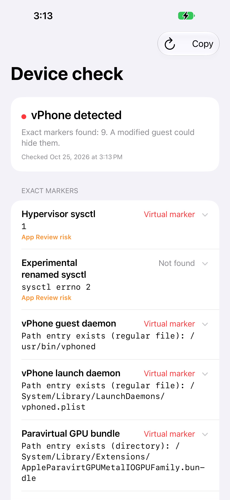
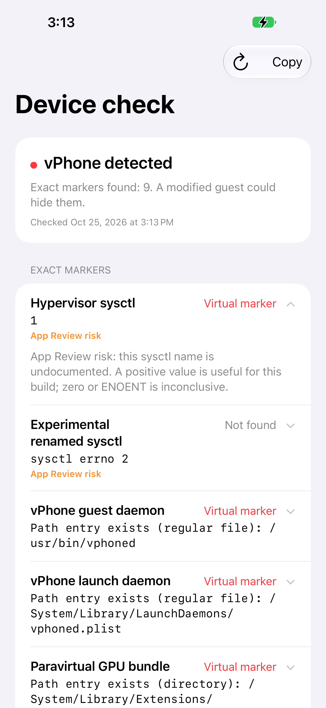

# 📱 vPhone Indicator Probe

[](https://github.com/Incognito-Lab/vphone-detection/actions/workflows/build-sample.yml)

A SwiftUI iPhone sample for inspecting app-visible vPhone indicators on **iOS 16 or later**. Every indicator keeps its status, observed value, and explanation alongside a provisional conclusion.



[📚 Research and detection indicators](../README.md)

<details>
<summary>🔎 See an indicator's expanded explanation</summary>



[🖼️ Screenshot provenance](Examples/Screenshots/README.md)

</details>

## 📦 Download an unsigned IPA

- [📥 Latest unsigned IPA](https://github.com/Incognito-Lab/vphone-detection/releases/latest/download/VPhoneIndicatorProbe-unsigned.ipa)
- [🔐 SHA-256 checksum](https://github.com/Incognito-Lab/vphone-detection/releases/latest/download/VPhoneIndicatorProbe-unsigned.ipa.sha256)
- [🏷️ Release notes and build information](https://github.com/Incognito-Lab/vphone-detection/releases)

These are unsigned iOS device builds. A physical iPhone requires your own signing and provisioning. A compatible guest installation route may re-sign the IPA; that establishes runtime visibility rather than normal iOS installation acceptance.

For development builds, open a successful [🛠️ Actions run](https://github.com/Incognito-Lab/vphone-detection/actions/workflows/build-sample.yml) and download its `unsigned-ipa-…` artifact. It contains the IPA, checksum, and build information, and is retained for 14 days.

<details>
<summary>🔁 Automated builds and releases</summary>

The [🛠️ workflow](../.github/workflows/build-sample.yml) builds sample-code, project, or packaging-script changes on pull requests and pushes to `main`. It can also be run manually. The build uses a GitHub-hosted `macos-26` runner with Xcode 26.6 and requires no Apple signing credentials.

Pushing a tag in the form `vMAJOR.MINOR.PATCH` builds that tagged source and publishes a GitHub Release containing the verified unsigned IPA, SHA-256 checksum, and build information. Only the tag-release job receives repository write permission. Pull-request and manual runs produce artifacts without publishing releases.

For example, after pushing a reviewed version to `main`:

```sh
git tag -a v0.2.0 -m "v0.2.0"
git push origin v0.2.0
```

To build the same package locally, run from this sample directory:

```sh
bash scripts/build-unsigned-ipa.sh
```

Outputs are written under `build/UnsignedIPA/`. To check the downloaded IPA, place it alongside its checksum file and run from that directory:

```sh
shasum -a 256 -c VPhoneIndicatorProbe-unsigned.ipa.sha256
```

The packaging verifier checks the device app, launch screen, deployment target, unsigned executable, archive layout, and absence of signing profiles or macOS metadata. A successful build is not a measurement of detection accuracy.

</details>

## 🚀 Quick start from source

1. On a Mac with Xcode, an installed iPhoneOS SDK, and Xcode command-line tools selected, open `VPhoneIndicatorProbe.xcodeproj`.
2. Select the shared **VPhoneIndicatorProbe** scheme. In **Signing & Capabilities**, select your own development team and a bundle identifier you can provision.
3. Connect a device you control, enable any developer settings required by its iOS version, and use **Run** when Xcode supports that device.

The project has no third-party package dependencies. For unsigned compilation, unsupported run destinations, or IPA installation, expand the build instructions below. The iOS Simulator does not substitute for a device or guest measurement.

## 📋 Run and export

Launch **vPhone Probe**. Checks start automatically; wait for the two-second motion sample to finish. Refresh starts a new run. Tap an indicator to expand its explanation; its status and complete observed value stay visible.

Tap **Copy** to export the entire text report. The app also saves `probe-report.txt` in its sandbox's Documents directory as results arrive. Retrieve it through an authorized app-container export in your development environment, or paste the copied report into a text file. There is no Files-app document browser.

Export after sampling completes. Keep every indicator's status, raw value, and explanation with the conclusion. Statuses include **Virtual marker**, **Possible mismatch**, **Not found**, **Observed**, **Unavailable**, **Pending**, and **Error**. An unavailable or blocked reading is not a negative hardware result.

## 🔎 Read the conclusion

| Result | Meaning |
| --- | --- |
| **vPhone detected** | At least one exact tested marker matched, including the tested identity strings. A modified guest can hide or change these values. |
| **Likely real device** | All eight direct checks completed without a match, and both identity strings were readable. This is provisional for the tested builds; it does not prove physical hardware. |
| **Inconclusive** | No exact marker matched, but a required check could not complete. |

Sanitized examples retain the complete per-indicator reports:

| Measured preset | Conclusion | Exact matches | Report |
| --- | --- | --- | --- |
| Standard | vPhone detected | 9 | [2026-10-25](Examples/Reports/standard-2026-10-25.txt) |
| Experimental | vPhone detected | 7 | [2026-10-25](Examples/Reports/experimental-2026-10-25.txt) |
| Physical reference | Likely real device | 0 | [2026-10-25](Examples/Reports/physical-2026-10-25.txt) |

**Tested Core Bundle:** [vPhone 2.12.0](https://github.com/Lakr233/vphone-cli/releases/tag/2.12.0), bound to both guests tested on **2026-10-25**. Later releases need retesting. The Experimental report's `iPhone17,3` / `D47AP` pair is this VM's observed identity, not a required value for every Experimental guest. Its installed 2.12.0 preset explicitly enables those identity rewrites. A guest's iOS version is separate from the vPhone release. The physical reference used a different model and OS; capability differences need that context. See the [📚 main research guide](../README.md) for the complete indicator comparison, provenance, and limits.

<details>
<summary>🧰 <strong>Technical checks and API boundaries</strong></summary>

| Group | Checks |
| --- | --- |
| Exact markers | Exact `Apple Paravirtual device GPU` Metal name; exact `/usr/lib/SystemHook-vphone.dylib` in `DYLD_INSERT_LIBRARIES`; four vPhone path entries; nonzero `kern.hv_vmm_present` or `kern.Xv_vmm_present` |
| Identity and consistency | `hw.machine`, `hw.model`, Metal GPU families, motion availability and two-second samples, camera discovery and formats, `hw.ncpu`, `hw.cputype`, `hw.cpusubtype`, `hw.memsize` |
| Context | iOS version and build |

The identity rows also count the exact tested `iPhone99,11` and `VPHONE600AP` strings as markers. CPU, memory, sensor, camera, and GPU-family differences require a baseline for the claimed model and OS; they do not independently establish virtualization.

The four path checks use public `lstat`:

- `/usr/bin/vphoned`
- `/System/Library/LaunchDaemons/vphoned.plist`
- `/System/Library/Extensions/AppleParavirtGPUMetalIOGPUFamily.bundle`
- `/usr/lib/SystemHook-vphone.dylib`

They inspect the path entry without reading file contents. If the final entry is a symbolic link, a separate `stat` describes whether its target resolves. The report distinguishes `ENOENT` from access denial and other errors. These are conventional public file APIs. The two hypervisor sysctl rows show **App Review risk** beneath the observed value, even when collapsed, because their OID names are undocumented. The path checks do not carry that label.

A zero or missing hypervisor OID alone does not rule out virtualization. This build contains no private IOKit or MobileGestalt calls and no App Attest implementation. It does not treat generic jailbreak artifacts as vPhone evidence. Camera discovery does not capture frames.

</details>

<details>
<summary>🛠️ <strong>Build without signing</strong></summary>

Run these commands from this sample directory:

```sh
xcodebuild -project VPhoneIndicatorProbe.xcodeproj \
  -scheme VPhoneIndicatorProbe -configuration Release -sdk iphoneos \
  -destination 'generic/platform=iOS' -derivedDataPath build/Unsigned \
  CODE_SIGNING_ALLOWED=NO build
```

The device binary is produced at `build/Unsigned/Build/Products/Release-iphoneos/VPhoneIndicatorProbe.app`. An unsigned build verifies compilation; normal iOS installation requires valid signing and provisioning.

The deployment target is iOS 16. Keep `INFOPLIST_KEY_UILaunchScreen_Generation = YES`: omitting the generated `UILaunchScreen` caused a measured physical iPhone run to use a 320×480 compatibility layout instead of its full 375×812 point screen.

</details>

<details>
<summary>📦 <strong>Sign, package, and install</strong></summary>

Keep automatic signing enabled in the target's **Signing & Capabilities**, select your own development team, and choose a unique bundle identifier you can provision. The checked-in identifier is a sample default; no signing team is included. Ensure the provisioning profile permits your device.

If the device is unavailable as an Xcode run destination but your toolchain can build for its OS, build for `generic/platform=iOS` using your signing configuration, then use your normal authorized installation workflow. A successful generic build alone does not verify installability.

After configuring your team and bundle identifier in Xcode:

```sh
xcodebuild -project VPhoneIndicatorProbe.xcodeproj \
  -scheme VPhoneIndicatorProbe -configuration Release -sdk iphoneos \
  -destination 'generic/platform=iOS' -derivedDataPath build/Signed \
  -allowProvisioningUpdates build
```

Verify the app signature, then check that the embedded profile is current and permits your device before installation. Do not commit signed apps, provisioning profiles, or signing credentials.

```sh
codesign --verify --deep --strict --verbose=2 \
  build/Signed/Build/Products/Release-iphoneos/VPhoneIndicatorProbe.app
```

If an installation tool requires an IPA, optionally package the signed app below. `ditto` places it under `Payload`, and `zip` runs inside the staging directory. Use a fresh package directory and output archive for each build.

```sh
mkdir -p build/Package/Payload
ditto --norsrc \
  build/Signed/Build/Products/Release-iphoneos/VPhoneIndicatorProbe.app \
  build/Package/Payload/VPhoneIndicatorProbe.app
python3 -c 'import subprocess; subprocess.run(["zip", "-r", "-X", "../VPhoneIndicatorProbe.ipa", "Payload", "-x", "*/._*", "*/.DS_Store"], cwd="build/Package", check=True)'
unzip -l build/VPhoneIndicatorProbe.ipa
```

The archive must contain `Payload/VPhoneIndicatorProbe.app` at its root and no macOS `._*` metadata entries; such entries caused an earlier measured installation failure. Packaging does not add signing or provisioning. Build and packaging outputs remain under the ignored `build/` directory.

</details>

<details>
<summary>🧪 <strong>Evidence collection and comparison limits</strong></summary>

Compare runs of the same probe logic and record model, OS, signing, installation route, and evidence collection method. Keep **sandboxed app** observations separate from **USB lockdown** readings, **privileged device access**, and **source-based expectation**.

The measured guest installation route re-signed the app and bypassed normal `installd` acceptance. Those runs establish runtime visibility, not acceptance through a standard signed installation path.

The physical reference was jailbroken; jailbreak processes, files, injection tooling, and security behavior are excluded from the virtualization comparison. Raw local reports, layout captures, and build products are excluded from the publication set.

</details>
